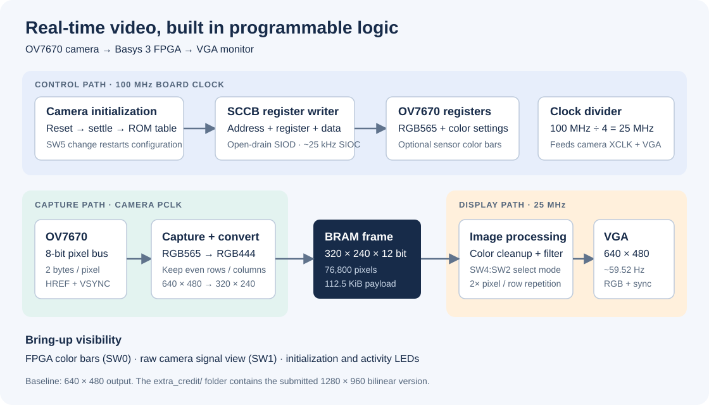
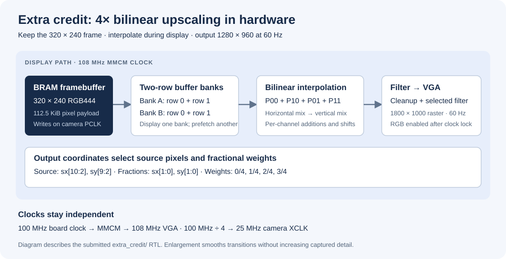
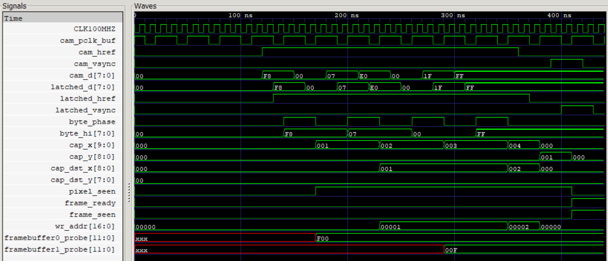
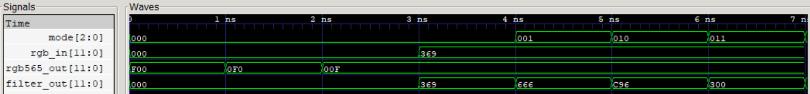

# FPGA Real-Time Video Capture & Processing

**An OV7670 camera-to-VGA pipeline with hardware image filters and bilinear upscaling, implemented in Verilog on the Digilent Basys 3.**

This project captures live camera pixels, stores a compact frame in FPGA block RAM, and applies switch-selectable image filters before displaying the result on a VGA monitor. Camera configuration, pixel capture, image processing, and display timing all run in programmable logic.

This repository preserves the completed project as submitted for grading in `project_code.zip`. It includes the **640 × 480 baseline** and the **1280 × 960 extra-credit implementation**, with the submitted HDL, testbenches, and constraints unchanged.

Developed by **AJ.JakeDotCom** for Hardware Synthesis Lab I at Chulalongkorn University, this project demonstrates RTL design, peripheral interfacing, memory budgeting, system integration, and simulation-based verification.



*Baseline pipeline. The extra-credit version adds a 108 MHz display clock and a bilinear scaler, described below.*

| At a glance | Implementation in this repository |
| --- | --- |
| Platform | Digilent Basys 3, Artix-7 `xc7a35tcpg236-1` |
| Language and tools | Verilog, AMD Vivado 2025.2, Icarus Verilog, VCD waveform inspection |
| Camera interface | OV7670, 8-bit parallel RGB565 stream; SCCB register configuration |
| Frame storage | 320 × 240, RGB444, 76,800 pixels in BRAM |
| Baseline display | 640 × 480 VGA with 2× pixel and row repetition |
| Extra-credit display | 1280 × 960 VGA with 4× bilinear upscaling and a 108 MHz display clock |
| Processing modes | Normal color, grayscale, inversion, red-only, green-only, blue-only |
| Verification | Five submitted testbenches per version; the extra-credit VGA timing test targets 1280 × 960 |

## My role

I led the team and took primary responsibility for system integration and debugging. We designed the system together and divided the module implementation across the team. I combined those modules, fixed integration issues, and developed the testbenches independently.

This work gave me experience taking separately developed RTL blocks through integration, diagnosing camera and display behavior, and using simulations to check the underlying logic.

## What the system does

- **Configures the camera automatically.** A hardware sequencer resets the OV7670, waits for stabilization, and writes a ROM-based register table over SCCB.
- **Captures and packs pixels.** The camera sends each RGB565 pixel as two bytes. Capture logic assembles the pixel and keeps every other source row and column.
- **Fits a complete frame into on-chip memory.** Pixels are converted to RGB444 and stored in a 320 × 240 framebuffer.
- **Processes the image during display.** Color balancing and gentle desaturation reduce red/purple bias, followed by the selected filter.
- **Supports hardware bring-up.** FPGA-generated color bars, the camera's internal test pattern, a raw camera-signal view, and status LEDs help isolate faults.

## Two implementations

| | [Baseline](baseline/) | [Extra credit](extra_credit/) |
| --- | --- | --- |
| Stored image | 320 × 240 RGB444 | 320 × 240 RGB444 |
| Display resolution | 640 × 480 | 1280 × 960 |
| Enlargement | Repeat each pixel in a 2 × 2 block | Blend neighboring pixels for 4× bilinear enlargement |
| Display clock | 25 MHz, divided from the board clock | 108 MHz, generated with an MMCM |
| Raster size | 800 × 525 | 1800 × 1000 |
| Calculated display refresh | Approximately 59.52 Hz | 60 Hz |
| Camera XCLK | 25 MHz | 25 MHz |

The shared source resolution keeps the main framebuffer at 112.5 KiB in both versions. Bilinear upscaling smooths transitions between source pixels; it does not add captured image detail.

```
README.md
baseline/
    source/         # Five submitted RTL modules
    simulation/     # Five submitted testbenches
    constraint/     # Basys 3 pin assignments and clock constraint
extra_credit/
    source/         # Seven submitted RTL modules, including scaler and MMCM
    simulation/     # Five submitted testbenches
    constraint/     # Extra-credit board constraints
scripts/
    create_project.tcl
docs/              # Report, illustrations, and submission manifest
```

Each version is built separately because its modules use the same names. The historical `baseline` Git branch preserves the original Vivado project; the `baseline/` folder on `main` contains the baseline files from the grading ZIP. Generated Vivado projects, caches, and run outputs are excluded from this portfolio branch.

## Architecture and design decisions

### Clock domains and data flow

The baseline design has three clock domains: the **100 MHz board clock** for camera configuration, the camera's **PCLK** for capture, and a divided **25 MHz clock** for VGA timing and framebuffer reads. The 25 MHz clock also supplies the camera's XCLK input.

1. The initialization controller reads camera register/value pairs from `ov7670_init_rom` and passes them to `sccb_write_byte`. The ROM includes delay and end-of-table markers.
2. Camera data, HREF, and VSYNC are latched on the falling PCLK edge and consumed on the next rising edge. Two bytes form one RGB565 pixel; even source coordinates are retained.
3. A BRAM framebuffer separates camera writes from display reads. Its address is calculated as `320*y + x` using `(y << 8) + (y << 6) + x`.
4. VGA coordinates map back to the stored frame using `sx[9:1]` and `sy[8:1]`. Each stored pixel fills a 2 × 2 output block.
5. The display path reads the pixel, applies color cleanup and the selected filter, and drives 4 bits per VGA color channel. RGB is blanked outside the visible area.

The extra-credit version keeps capture and camera configuration but reads the framebuffer through a bilinear scaler in the 108 MHz display domain. VGA output is enabled after the MMCM locks and valid scaler data is available.

### Memory and arithmetic tradeoffs

A full 640 × 480 RGB565 frame requires **600 KiB** of pixel storage. The chosen 320 × 240 RGB444 frame requires **112.5 KiB**, an **81.25% reduction in pixel payload**. These are calculated storage sizes; physical BRAM allocation also depends on memory packing.

RGB444 matches the Basys 3 VGA output's 4-bit color channels. Downsampling reduces memory demand, while doubling pixels fills the display without a larger framebuffer. Address generation and coordinate scaling use shifts and additions, and grayscale uses `(R + 2G + B) >> 2`. These choices keep the datapath simple; the historical baseline implementation report records no DSP use.

The compromise is lower spatial and color resolution. Pixel repetition makes the image larger but adds no detail, and the board-specific color cleanup trades some color accuracy for reduced visible noise.

### Camera configuration and filtering

SCCB is the OV7670's register interface. Each transaction sends the device write address `0x42`, a register address, and a register value. SIOD is open-drain: the FPGA drives it low or releases it for the pull-up. The default divider produces approximately **25 kHz SIOC**, suitable for startup configuration.

The image cleanup path uses saturating channel adjustments and dark-pixel thresholds to suppress low-light red speckles and reduce purple/red bias. Gentle desaturation moves strongly biased channels toward a weighted gray value. Sensor color-bar mode bypasses this cleanup so the camera test pattern can be inspected directly.

### Module responsibilities

| Module | Responsibility |
| --- | --- |
| [`top_ov7670_fifo_vga.v`](baseline/source/top_ov7670_fifo_vga.v) | Clock division, capture, framebuffer, image processing, VGA selection, and debug LEDs; the [extra-credit top](extra_credit/source/top_ov7670_fifo_vga.v) also integrates the MMCM and scaler |
| [`vga_640x480.v`](baseline/source/vga_640x480.v) | Raster coordinates, active-video window, and sync; the [extra-credit version](extra_credit/source/vga_640x480.v) retains the filename but implements 1280 × 960 timing |
| [`sccb_write_byte.v`](baseline/source/sccb_write_byte.v) | One SCCB register-write transaction and completion handshake |
| [`ov7670_init_controller.v`](baseline/source/ov7670_init_controller.v) | Camera reset, settling delays, ROM sequencing, and reconfiguration |
| [`ov7670_init_rom.v`](baseline/source/ov7670_init_rom.v) | Camera register/value table, including test-pattern selection |
| [`bilinear_upscaler_4x.v`](extra_credit/source/bilinear_upscaler_4x.v) | Alternating row-buffer banks, prefetching, and per-channel bilinear interpolation |
| [`vga_clock_108.v`](extra_credit/source/vga_clock_108.v) | MMCM and global buffers generating the 108 MHz display clock |
| `basys3_ov7670_fifo.xdc` | Separate [baseline](baseline/constraint/basys3_ov7670_fifo.xdc) and [extra-credit](extra_credit/constraint/basys3_ov7670_fifo.xdc) pin and timing constraints |

### Extra-credit bilinear upscaling



The scaler reads two neighboring source rows into alternating buffer banks. One bank can supply display pixels while the other prepares upcoming rows. Four source samples (`P00`, `P10`, `P01`, `P11`) are blended horizontally and then vertically, independently for red, green, and blue.

For 4× enlargement, the source coordinates come from `sx[10:2]` and `sy[9:2]`. The lower two coordinate bits select fractional weights of 0/4, 1/4, 2/4, or 3/4. This allows interpolation using additions and shifts instead of general-purpose multipliers. The submitted scaler also clamps neighboring reads at the right and bottom boundaries and adjusts the first source column for the reported left-edge artifact.

The MMCM converts the 100 MHz board clock to 108 MHz using `100 × 54 / (5 × 10)`. Camera XCLK remains 25 MHz. The 1800 × 1000 raster at 108 MHz gives a calculated 60 Hz display refresh rate.

## Verification and implementation evidence

The [project report](docs/AJJake_Report.pdf) documents passing results for the five baseline testbenches. Both submitted testbench sets are included: [baseline simulations](baseline/simulation/) and [extra-credit simulations](extra_credit/simulation/). The extra-credit VGA testbench checks the 1280 × 960 raster, a 108 MHz test clock, and positive sync pulses. There is no dedicated bilinear-scaler testbench in the submitted ZIP.

These are archived submission files and reported results; this repository cleanup does not constitute a new hardware validation or synthesis run.

| Testbench | What it checks |
| --- | --- |
| `tb_vga_640x480` | One full raster frame, visible-pixel count, and horizontal/vertical sync pulse widths; variant-specific resolution and polarity |
| `tb_sccb_write_byte` | One transaction, SIOC activity, a single completion pulse, and return to idle |
| `tb_ov7670_init_controller` | Initial configuration and a second initialization after a color-bar toggle |
| `tb_top_capture_filters` | Synthetic RGB565 input, horizontal downsampling, framebuffer writes, and frame-ready detection |
| `tb_top_filter_functions` | Primary-color conversion and exact outputs for all six filter modes |



*Capture waveform from report page 42. A synthetic red/green/blue/white line stores red as `F00` and blue as `00F`, skipping the odd source pixels. VSYNC then sets `frame_ready`.*

### Filter waveform and expected values



*Waveform from report page 46. The testbench checks the following outputs for RGB444 input `369`:*

| Mode | Normal | Grayscale | Invert | Red only | Green only | Blue only |
| --- | --- | --- | --- | --- | --- | --- |
| Expected output | `369` | `666` | `C96` | `300` | `060` | `009` |


### Historical baseline FPGA implementation results

The [original baseline placed utilization report](https://github.com/theerapas/hwsyn_AJ_JakeDotCom/blob/baseline/project_1/project_1.runs/impl_1/top_ov7670_fifo_vga_utilization_placed.rpt), preserved on the historical `baseline` branch and generated with Vivado 2025.2 on May 13, 2026, records:

| Resource | Used | Available | Utilization |
| --- | ---: | ---: | ---: |
| Slice LUTs | 428 | 20,800 | 2.06% |
| Slice registers | 234 | 41,600 | 0.56% |
| Block RAM tiles | 36 | 50 | 72.00% |
| DSPs | 0 | 90 | 0.00% |

These figures describe the historical baseline build, rather than a fresh synthesis of the submitted files or the extra-credit version. They show memory as the dominant resource cost.

The [historical baseline routed timing report](https://github.com/theerapas/hwsyn_AJ_JakeDotCom/blob/baseline/project_1/project_1.runs/impl_1/top_ov7670_fifo_vga_timing_summary_routed.rpt) records **+4.486 ns setup slack** and **0 ns total negative slack** for the specified constraints. It also flags unclocked sequential cells and unconstrained endpoints in the camera and divided-clock paths, plus missing I/O delays. This establishes that the specified constraints passed, but does not establish timing closure for the complete video pipeline.

## Run on hardware

### Requirements

- A Basys 3 board and USB programming connection.
- An OV7670 camera connected to the signals mapped in the project's XDC file.
- A VGA monitor and cable.
- Vivado with Artix-7 device support; the saved project was created with version 2025.2.

### Build and bring-up

From a terminal with Vivado on PATH, create the project for the version you want:

```powershell
vivado -mode batch -source scripts/create_project.tcl -tclargs baseline
# Or create the extra-credit project separately:
vivado -mode batch -source scripts/create_project.tcl -tclargs extra_credit
```

The [project creation script](scripts/create_project.tcl) adds only the selected version's submitted files. It creates `build/baseline/video_baseline.xpr` or `build/extra_credit/video_extra_credit.xpr`, targets `xc7a35tcpg236-1`, and sets the hardware top to `top_ov7670_fifo_vga`. It does not run synthesis or generate a bitstream. The `build/` directory is ignored by Git.

If using the GUI, create a new RTL project for the same part, add one version's `source/*.v`, `simulation/*.v` as simulation sources, and its `constraint/*.xdc`. Do not combine files from both versions in one project.

1. Open the generated project in Vivado. Match the camera wiring to that version's XDC file, including D0-D7, PCLK, HREF, VSYNC, XCLK, RESET, PWDN, SIOC, and SIOD. Use the camera module's specified power connection and a common ground.
2. Run synthesis, implementation, and bitstream generation. Review timing and methodology reports; the historical baseline timing result does not certify a new build or the extra-credit version.
3. Program the board through Vivado Hardware Manager and connect a monitor supporting the selected display mode.
4. Set **SW0 = 1** to check the VGA connection using FPGA-generated color bars. Then set SW0 back to 0.
5. With **SW1 = 0**, set **SW5 = 1** to check the camera's internal color bars. Changing SW5 restarts camera configuration; wait for **LED0** to indicate completion.
6. Set **SW5 = 0** for the live camera image and select a filter with SW4-SW2.

### Controls

| Switch | Function |
| --- | --- |
| SW0 | FPGA-generated VGA color bars; highest display priority |
| SW1 | Raw camera-signal debug view; used when SW0 is off |
| SW4-SW2 | Filter selection, with SW4 as the most significant bit |
| SW5 | Camera internal color bars; toggling triggers reinitialization and bypasses image cleanup |
| SW7-SW6 | Unused for image processing; mirrored on debug LEDs |

| SW4 SW3 SW2 | Filter |
| --- | --- |
| `000` | Normal color after image cleanup |
| `001` | Grayscale |
| `010` | Color inversion |
| `011` | Red only |
| `100` | Green only |
| `101` | Blue only |
| `110`, `111` | Default to normal color |

For camera images and filters, keep SW0 and SW1 off. Useful bring-up indicators are **LED0** (initialization completed), **LED1/LED2** (VSYNC/HREF seen), **LED8** (frame detected), and **LED11** (PCLK seen). LED3 reflects PCLK activity and may change too quickly to interpret visually.

### Run simulations

In the project for the selected version, open **Simulation Sources**, set the desired testbench as the simulation top, and run behavioral simulation. The creation script defaults to `tb_vga_640x480`, which tests the appropriate raster for each version. Check the printed `PASS` or `FAIL` result; the submitted tests use `$finish`, so successful process exit alone is insufficient.

For simulations that instantiate the extra-credit top, the MMCM and BUFG primitives require Vivado simulation libraries. The submitted `vga_clock_108.v` has an Icarus-specific bypass that passes through 100 MHz and asserts lock; this bypass does not simulate the actual 108 MHz MMCM behavior.

## Challenges and lessons

The report identifies camera register configuration, multiple clock domains, red noise, and color/brightness tuning as the main challenges. Separating the SCCB writer, initialization sequencer, and VGA timing generator made those blocks easier to inspect individually. Test patterns and status LEDs gave the integration work observable checkpoints before relying on a live image.

The project also illustrates why resolution, color depth, and memory allocation must be designed together: the framebuffer consumes much more FPGA capacity than the control and filter logic.

### Scope and known limitations

- **Single framebuffer:** camera capture and display share one frame store without a frame-swap scheme, so tearing is possible.
- **Clock-domain crossings:** camera-domain status flags are consumed by display/control logic without a complete synchronization handshake. The submission does not provide a complete CDC validation.
- **Timing constraints:** camera PCLK, the divided pixel clock, and external I/O timing need complete constraints and a renewed timing review. PCLK currently uses a non-clock-capable pin with a routing override in the XDC.
- **SCCB diagnostics:** the writer releases SIOD for the ninth bit but does not validate camera acknowledgement or retry failed writes. LED0 indicates sequencer completion rather than confirmed camera communication.
- **Validation scope:** focused simulations cover block behavior and a short synthetic capture line; they do not establish full-frame, end-to-end hardware performance or measured camera frame rate.
- **Display timing:** 25 MHz with an 800 × 525 raster yields approximately 59.52 Hz. This is the project's nominal 60 Hz VGA mode; monitor compatibility depends on the display.

### Submission provenance

The authoritative source is the grading archive `project_code.zip`. Its `project_code/main/` contents map to `baseline/`, and its `project_code/extra_credit/` contents map to `extra_credit/`. All 24 source, simulation, and constraint files are preserved byte-for-byte, including comments and line endings.

The [submission manifest](docs/submission-manifest.json) records the archive SHA-256 and each file's original archive path, destination, byte count, and SHA-256. The portfolio organization and build script are added documentation/support files; the submitted HDL and tests are unmodified.

The original development branches remain as history. The project is complete and is not under active development.

## Team and documentation

**Team AJ.JakeDotCom:** พอฤทัย ชินกาญจนโรจน์, พารมี พีรภาพ, ธีรภาส อภินันท์กูล, and วัทธิกร หนองน้ำขาว.

The [full project report](docs/AJJake_Report.pdf) contains the original block diagrams, module explanations, simulation evidence, challenges, and the upscaling extension. This README summarizes that report and cross-checks implementation details against the submitted RTL. Historical baseline build figures are identified separately. The architecture illustration is a documentation diagram; the waveform images are extracted from the report.

The report discloses AI assistance with color-balance/desaturation functions, extracting register settings, debugging and synthesis analysis, testbench scaffolding, and code comments.
